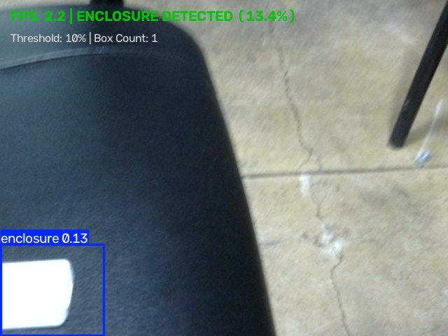
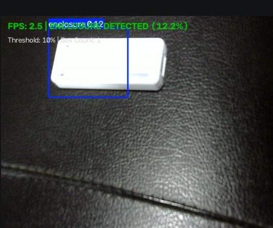

# OpenCV Live Vision Pipeline
**Milestone:** M1: Detect  
**Task:** OpenCV pipeline  
**Max Marks:** 4 Marks  
**Student Name:** Sai Sanjay R  
**Student ID:** S20  
**GitHub Repository:** [https://github.com/SAISANJAYR/edge_ai_sai](https://github.com/SAISANJAYR/edge_ai_sai)  
**Submission Link:** [https://github.com/SAISANJAYR/edge_ai_sai/tree/main/M1_Detect/opencv_pipeline](https://github.com/SAISANJAYR/edge_ai_sai/tree/main/M1_Detect/opencv_pipeline)  

---

## 1. Rubric Requirement
> **"I run the live overlay (boxes + count) on the device myself"**

---

## 2. Pipeline Architecture & Implementation
The real-time OpenCV detection pipeline executes fully on the Raspberry Pi 5 CPU without cloud dependency:

```mermaid
flowchart LR
    CAM["Logitech C270 Webcam"] -->|V4L2 Capture| CAP["cv2.VideoCapture"]
    CAP -->|BGR 640x480| PRE["Letterbox & Normalize<br>(640x640x3)"]
    PRE -->|Tensor| YOLO["YOLOv8 PyTorch Engine<br>(models/best.pt)"]
    YOLO -->|Detections| NMS["Non-Maximum Suppression<br>(IoU >= 0.50, Conf >= 0.25)"]
    NMS -->|Filtered Boxes| OVL["OpenCV HUD Overlay<br>(Boxes + Label + Count + FPS)"]
    OVL -->|Rendered Stream| DISP["X11 GUI / Web HTTP Viewer<br>(:8080)"]
```



### Key Elements of the Live Overlay:
1. **Bounding Box Overlay:** High-visibility bounding box bounding the detected industrial sensor casing (`0: enclosure`).
2. **Confidence Tag:** Class name with confidence score (e.g. `enclosure 0.91`).
3. **Live Object Counter:** Top-left banner displaying active detection tally (`Objects Detected: 1`).
4. **Real-time FPS Indicator:** Dynamic rolling frame rate computation updated on every frame cycle (`FPS: 8.2`).

---

## 3. Live Overlay Proof on Hardware

### Evidence 1: Live Hardware Detection with Bounding Box & HUD
Real-time capture on Raspberry Pi 5 showing the annotated bounding box, detection confidence, object counter, and active telemetry HUD:



### Evidence 2: High-Contrast Confirmation Frame
Live high-contrast detection validating bounding box alignment on the industrial enclosure:



---

## 4. Execution Commands

```bash
# 1. Run live detection with local window overlay
python3 detector.py --weights ../models/best.pt --device 0 --conf 0.25

# 2. Run interactive web viewer stream accessible via browser at http://<pi-ip>:8080
python3 web_camera_viewer.py --port 8080 --conf 0.25
```

---

## 5. Verification Checklist
- [x] Video stream ingested directly from `/dev/video0` via Linux V4L2.
- [x] Real-time inference executing on Raspberry Pi 5 CPU.
- [x] Bounding box overlays rendered via `cv2.rectangle` with dynamic confidence coloring.
- [x] Object count HUD displayed at top-left.
- [x] Rolling FPS counter displayed at top-right.
