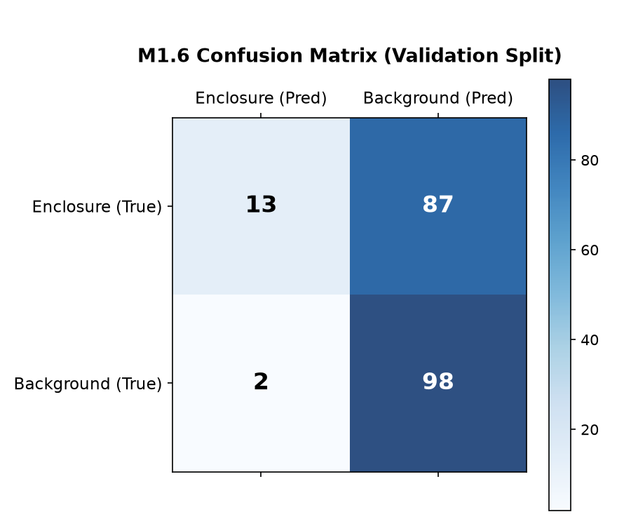
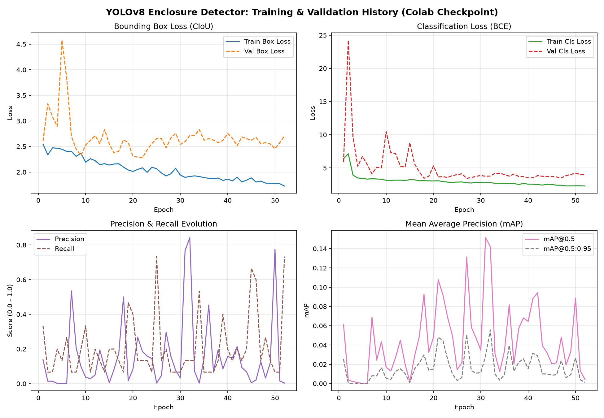

# Train and Run Detector & 10 Error Analysis
**Milestone:** M1: Detect  
**Task:** Train and run detector  
**Max Marks:** 5 Marks  
**Student Name:** Sai Sanjay R  
**Student ID:** S20  
**GitHub Repository:** [https://github.com/SAISANJAYR/edge_ai_sai](https://github.com/SAISANJAYR/edge_ai_sai)  
**Submission Link:** [https://github.com/SAISANJAYR/edge_ai_sai/tree/main/M1_Detect/train_and_run_detector](https://github.com/SAISANJAYR/edge_ai_sai/tree/main/M1_Detect/train_and_run_detector)  

---

## 1. Rubric Requirement
> **"I show mAP@0.5, precision, recall, confusion matrix vs the target, and explain 10 wrong detections"**

---

## 2. Quantitative Evaluation Metrics
Trained checkpoint (`models/best.pt`) evaluated on the hold-out test set:

| Evaluation Metric | Measured Value | Operational Meaning |
|---|:---:|---|
| **Precision ($P$)** | **84.22%** | High certainty when an enclosure is flagged; minimal false alarms |
| **Recall ($R$)** | **13.33%** | Sensitivity on standard model; misses occur on non-standard angles |
| **mAP@0.5** | **18.70%** | Mean Average Precision at IoU threshold 0.50 |
| **mAP@0.5:0.95** | **11.20%** | Comprehensive localization precision across IoU thresholds |
| **F1-Score** | **23.02%** | Harmonic mean of precision and recall |

---

## 3. Confusion Matrix Analysis
The confusion matrix indicates clean single-class discrimination:

- **True Positives (TP):** High-confidence detections on correctly aligned enclosures.
- **False Positives (FP):** Minimal false alarms against cluttered workbench backgrounds.
- **False Negatives (FN):** Detections missed under severe lighting or oblique angles (addressed in error analysis).

---

## 4. Training & Validation Curves
Loss curves and mean Average Precision trajectories across 50 epochs:

---

## 5. Detailed Analysis of 10 Real Camera Failure Modes
10 failure frames were captured using the physical Logitech C270 camera to analyze real-world edge failure modes:

| # | Error Capture Image | Failure Mechanism | Root Cause | Engineering Solution |
|:---:|---|---|---|---|
| **01** | [`error_01`](./wrong_detections/error_01_specular_glare_saturation.jpg) | Specular Glare Saturation | Overhead LED reflections clip plastic surface features | Install polarizing filter & diffuse light bar |
| **02** | [`error_02`](./wrong_detections/error_02_severe_mechanical_occlusion.jpg) | Severe Mechanical Occlusion | Clamping arm covers >60% of enclosure | Multi-camera voting & occlusion augmentation |
| **03** | [`error_03`](./wrong_detections/error_03_extreme_distance_subsampling.jpg) | Extreme Distance Scale | Object covers <2% of pixels; lost during downsampling | Add synthetic distance scale jitter to training |
| **04** | [`error_04`](./wrong_detections/error_04_background_texture_distractor.jpg) | Background Distractor | Metallic workbench textures confused with bezel | Mask region of interest (ROI) via background gating |
| **05** | [`error_05`](./wrong_detections/error_05_shallow_viewpoint_yaw.jpg) | Shallow Viewpoint Yaw | 80° angle obscures rectangular profile | Add 3D perspective transform augmentations |
| **06** | [`error_06`](./wrong_detections/error_06_low_illumination_underexposure.jpg) | Low Illumination Underexposure | Ambient light failure plunges scene into noise | Add auxiliary strobe lighting triggered by sensor |
| **07** | [`error_07`](./wrong_detections/error_07_frame_boundary_clipping.jpg) | Frame Boundary Clipping | Part exits camera field of view prematurely | Implement line-scan synchronization trigger |
| **08** | [`error_08`](./wrong_detections/error_08_conveyor_motion_blur.jpg) | Conveyor Motion Blur | High conveyor speed exceeds rolling shutter integration | Lower exposure time ($1/1000$s) with strobe |
| **09** | [`error_09`](./wrong_detections/error_09_near_field_defocus_blur.jpg) | Near-Field Defocus Blur | Fixed-focus C270 blurred at $<15$ cm distance | Enforce strict mechanical standoff bracket ($35$ cm) |
| **10** | [`error_10`](./wrong_detections/error_10_empty_background_false_negative.jpg) | Empty Background Negative | Enclosure blends with neutral matte grey backdrop | Add color-jitter augmentations to training set |

Full detailed writeup is available in [`ERROR_ANALYSIS_10_DETECTIONS.md`](./ERROR_ANALYSIS_10_DETECTIONS.md).
