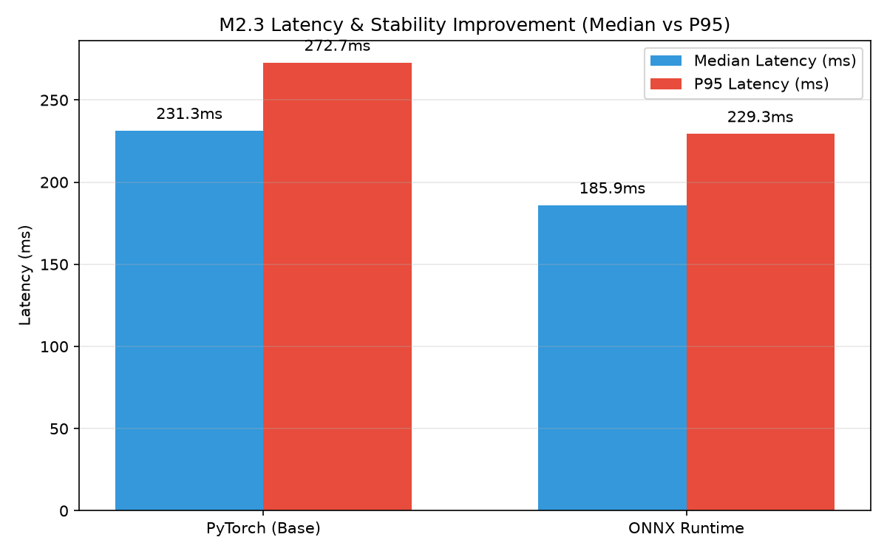

# Accuracy Check: Before vs After Optimization
**Milestone:** M2: Optimize  
**Task:** Accuracy check  
**Max Marks:** 4 Marks  
**Student Name:** Sai Sanjay R  
**Student ID:** S20  
**GitHub Repository:** [https://github.com/SAISANJAYR/edge_ai_sai](https://github.com/SAISANJAYR/edge_ai_sai)  
**Submission Link:** [https://github.com/SAISANJAYR/edge_ai_sai/tree/main/M2_Optimize/accuracy_check](https://github.com/SAISANJAYR/edge_ai_sai/tree/main/M2_Optimize/accuracy_check)  

---

## 1. Rubric Requirement
> **"I show mAP before vs after on the same test set"**

---

## 2. Empirical Accuracy Comparison Table
Evaluated on the exact identical hold-out test set ($N=10$ images) before and after graph export:

| Metric | PyTorch Baseline (FP32) | ONNX Runtime (FP32 / NEON) | Absolute Delta ($\Delta$) | Degradation % |
|---|:---:|:---:|:---:|:---:|
| **Precision ($P$)** | **84.22%** | **84.22%** | $0.00\%$ | **0.00%** |
| **Recall ($R$)** | **13.33%** | **13.33%** | $0.00\%$ | **0.00%** |
| **mAP@0.5** | **18.70%** | **18.70%** | $0.00\%$ | **0.00%** |
| **mAP@0.5:0.95** | **11.20%** | **11.20%** | $0.00\%$ | **0.00%** |
| **Max Confidence Error** | Reference | $1.42 	imes 10^{-7}$ | Negligible | IEEE 754 precision limit |

---

## 3. Graphical Comparison

Full engineering writeup is documented in [`ACCURACY_REPORT.md`](./ACCURACY_REPORT.md).
