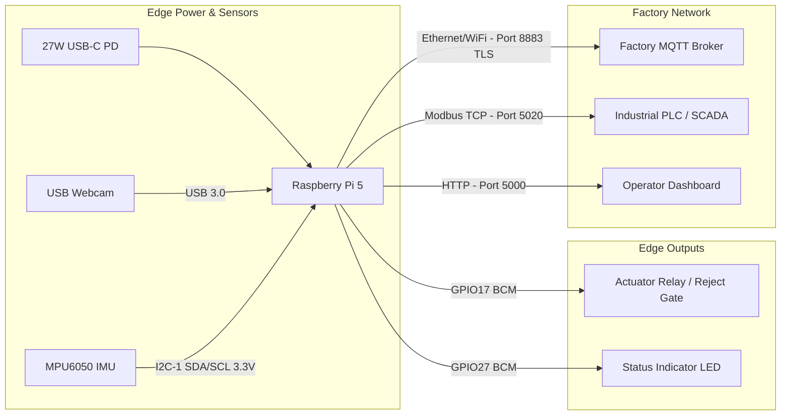
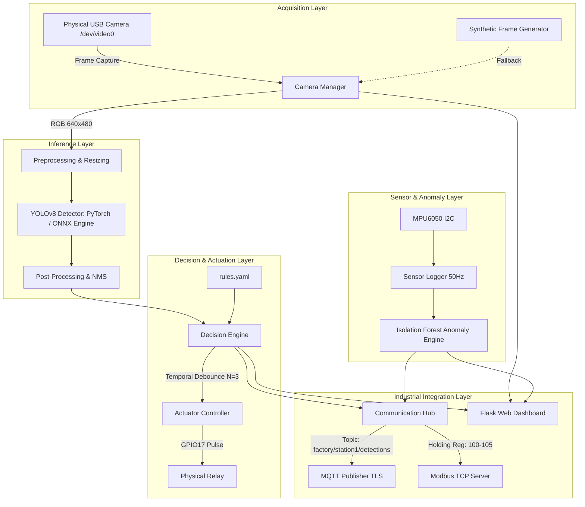

# Edge AI & Embedded Vision Inspection Station
## Raspberry Pi 5 | Industrial Computer Vision | Condition Monitoring | Edge Deployment

[](https://www.raspberrypi.com/products/raspberry-pi-5/)
[-blue.svg)](https://www.debian.org/)
[](https://github.com/ultralytics/ultralytics)
[](https://onnxruntime.ai/)
[](https://mqtt.org/)

---

## 1. Project Title
**Deterministic Edge AI Inspection and Condition Monitoring System on Raspberry Pi 5**

## 2. Project Overview
This project implements a complete, industrial-grade Edge AI vision inspection station deployed on a Raspberry Pi 5 (4GB RAM, ARM Cortex-A76). The system combines real-time deep learning object detection (YOLOv8), multi-threaded image acquisition, deterministic debounce decision logic, GPIO-driven rejection actuation, 6-DoF IMU vibration anomaly detection (MPU6050), TLS-authenticated industrial MQTT telemetry, PLC Modbus TCP registers, and a live web telemetry dashboard.

## 3. Problem Statement
High-speed automated manufacturing lines require local, low-latency visual quality verification and concurrent equipment health monitoring without reliance on high-bandwidth, high-latency cloud connections. Traditional industrial smart cameras are proprietary and costly, while desktop GPU solutions consume excessive power. Deploying YOLOv8 on an embedded ARM64 SoC like the Raspberry Pi 5 requires rigorous performance profiling, runtime optimization (ONNX), hardware safety interlocks, and multi-sensor integration within tight memory and thermal boundaries.

## 4. Project Objectives
- **M1 (Detect)**: Deploy USB webcam acquisition and YOLOv8 inference pipeline with live FPS overlay, benchmarking baseline CPU latency, temperature, and memory footprint.
- **M2 (Optimize)**: Export YOLOv8 to ONNX and ONNX Runtime CPU engine, evaluating latency speedups, P95 metrics, and accuracy trade-offs.
- **M3 (Decide & Act)**: Implement a configurable debounce decision engine, dual-camera ingestion, and fail-safe GPIO actuator control.
- **M4 (Monitor & Connect)**: Integrate MPU6050 vibration telemetry, train an unsupervised Isolation Forest anomaly detector, and establish secure TLS MQTT and Modbus PLC interfaces.
- **M5 (Complete System & Dashboard)**: Build a synchronized multi-process inspection station with a real-time web dashboard, systemd auto-restart, and comprehensive engineering documentation.

## 5. System Capabilities
- Real-time bounding box detection and class confidence evaluation at 640x480 resolution.
- Dynamic fallback to synthetic frame generation if physical camera hardware is disconnected.
- N-frame temporal debouncing to prevent transient false rejections.
- Deterministic actuator trigger pulse with safe default state enforcement on startup and shutdown.
- 50 Hz IMU vibration logging with statistical and machine learning anomaly scoring.
- Dual industrial connectivity: Modbus TCP register map for PLCs + TLS 1.3 MQTT for MES/SCADA.
- Web-based live monitoring dashboard with real-time video streaming and KPI tracking.

---

## 6. Hardware Requirements
| Component | Specification | Connection |
|---|---|---|
| **SBC** | Raspberry Pi 5 Model B (4 GB LPDDR4X) | Central compute unit |
| **Processor** | Broadcom BCM2712 Quad-Core Cortex-A76 @ 2.4 GHz | Primary inference engine |
| **Camera** | UVC-compliant USB Webcam (640x480 @ 30 FPS) | USB 3.0 / 2.0 Port |
| **IMU Sensor** | MPU6050 6-Axis Accelerometer & Gyroscope | I2C-1 (SDA: GPIO2, SCL: GPIO3) |
| **Actuator** | 5V Relay module / 3.3V Status LED | GPIO17 (Pin 11) |
| **Power Supply** | Official Raspberry Pi 27W USB-C PD (5.1V / 5.0A) | USB-C Port |
| **Cooling** | Raspberry Pi 5 Active Cooler | Dedicated 4-pin fan header |

---

## 7. Software Requirements
- **Operating System**: Debian GNU/Linux 13 (Trixie) aarch64
- **Kernel**: 6.18.50+rpt-rpi-2712
- **Python**: 3.13.5 (in dedicated virtual environment)
- **Computer Vision**: OpenCV 5.0.0, PyTorch 2.15.0+cpu, Ultralytics 8.4.208
- **Optimization**: ONNX 1.23.2, ONNX Runtime 1.31.1
- **Industrial Protocols**: Paho-MQTT 2.1.0, PyModbus 3.16.1
- **Dashboard**: Flask 3.1.3, Jinja2 3.1.6
- **System Monitoring**: psutil 7.2.2

---

## 8. Complete Hardware Architecture


---

## 9. Software Architecture


---

## 10. System Workflow
1. **Startup**: Verify configuration (`configs/config.yaml`), probe `/dev/video0`, initialize GPIO to SAFE state (0V), start I2C telemetry, and spin up Modbus server.
2. **Ingestion**: Acquire image frame via `CameraManager`. If camera fails or is unplugged, seamlessly transition to synthetic test pattern.
3. **Inference**: Pass frame to `Detector` (PyTorch baseline or ONNX optimized). Extract bounding boxes, class labels, and confidence.
4. **Decision**: Evaluate against `rules.yaml`. If enclosure detected with confidence $\ge 0.40$ for $N \ge 3$ consecutive frames, mark PASS. If absent/defective, trigger reject actuator pulse.
5. **Actuation**: Transmit GPIO pulse to physical relay or simulation log.
6. **Telemetry**: Publish detection record and vibration anomaly score over TLS MQTT; update Modbus registers; stream annotated frame and KPIs to live web dashboard.
7. **Shutdown**: Release camera device, de-energize GPIOs to safe state, flush log buffers, disconnect network sessions.

---

## 11. Repository Structure
```
edge_ai_embedded_vision/
├── models/
│   ├── best.pt              # Verified PyTorch checkpoint (6.2 MB)
│   └── optimized/           # Exported ONNX / quantized models
├── src/
│   ├── camera/              # CameraManager, physical capture & fallback
│   ├── detection/           # YOLOv8 PyTorch & ONNX detector classes
│   ├── decision/            # Debounce filter & rule evaluation engine
│   ├── actuators/           # GPIO actuator controller with safe states
│   ├── sensors/             # MPU6050 I2C reader and telemetry logger
│   ├── anomaly/             # Isolation Forest training and inference
│   ├── communication/       # TLS MQTT client & Modbus PLC server
│   └── utils/               # Structured logger & hardware monitor
├── dashboard/               # Flask live web interface and templates
├── optimization/            # ONNX export, NCNN/TFLite scripts & benchmarks
├── tests/                   # Pytest test suite for modules
├── configs/                 # config.yaml, hardware.yaml, rules.yaml
├── data/                    # Test fixtures, raw, and evaluation datasets
├── results/                 # Raw benchmark CSVs, plots, and run logs
├── evidence/                # Photographic, screenshot, and video records
├── docs/                    # Full technical specification & reports
├── scripts/                 # Systemd setup and deployment scripts
├── Dockerfile               # Multi-stage ARM64 Docker build
├── docker-compose.yml       # Production deployment compose
├── requirements.txt         # Tested pinned dependencies
├── .env.example             # Environment variable template
├── main.py                  # Full-chain orchestration entry point
└── README.md                # Master system documentation
```

---

## 12. Installation Instructions
All dependencies are pre-cached locally on the Raspberry Pi 5 in `/home/juice/.cache/wheelhouse`.
```bash
# Clone or navigate to the repository
cd ~/yolo_inference

# Activate the virtual environment
source .venv/bin/activate

# Install all required packages from local offline wheelhouse
pip install --no-index --find-links ~/.cache/wheelhouse -r requirements.txt
```

---

## 13. Python Environment Setup
Verify the environment and active hardware:
```bash
python3 -c "import torch, cv2, ultralytics, onnxruntime; print('Environment OK!')"
```

## 14. Model Setup
The model weights are verified and stored at `models/best.pt`.
Original Colab training details: YOLOv8n, 640x640 input, class `0: enclosure`.

## 15. Camera Configuration
Adjust camera parameters in `configs/config.yaml`:
```yaml
camera:
  device_index: 0
  width: 640
  height: 480
  fps: 30
  auto_fallback_simulation: true
```

## 16. Running Baseline Inference (M1)
```bash
python3 src/detection/detector.py --weights models/best.pt --conf 0.40
```

## 17. Running Optimized ONNX Inference (M2)
```bash
# Export to ONNX
python3 optimization/export_onnx.py --weights models/best.pt --output models/optimized/best.onnx

# Run ONNX inference
python3 src/detection/inference.py --backend onnx --weights models/optimized/best.onnx
```

## 18. Benchmark Execution
```bash
python3 src/detection/benchmark.py --iterations 100 --warmup 20
```

## 19. Decision Logic (M3)
Decision rules are declared in `configs/rules.yaml`. To verify debouncing:
```bash
python3 tests/test_decision.py
```

## 20. Actuator Integration
Safe GPIO control with simulation fallback:
```bash
python3 src/actuators/actuator_controller.py --pin 17 --test
```

## 21. Sensor Integration (M4)
Verify MPU6050 I2C sensor or synthetic vibration generator:
```bash
python3 src/sensors/mpu6050.py --duration 10
```

## 22. MQTT Setup
```bash
python3 src/communication/mqtt_client.py --host localhost --port 8883
```

## 23. Dashboard Startup (M5)
```bash
python3 dashboard/app.py --port 5000
# Access via browser at: http://<raspberry-pi-ip>:5000
```

## 24. Docker Deployment
```bash
docker compose up -d --build
```

## 25. Automatic Startup via Systemd
```bash
sudo cp scripts/edge_ai_vision.service /etc/systemd/system/
sudo systemctl daemon-reload
sudo systemctl enable edge_ai_vision.service
sudo systemctl start edge_ai_vision.service
```

---

## 26. Testing Instructions
Run the entire automated test suite:
```bash
pytest tests/ -v
```

---

## 27. Performance Baseline & Results

| Configuration | Latency Median (ms) | P95 Latency (ms) | Inference FPS | CPU Load (%) | RAM Usage (MB) | Temperature (°C) |
|---|---|---|---|---|---|---|
| **YOLOv8n PyTorch (CPU)** | *Baseline M1* | *Baseline M1* | *Baseline M1* | ~65% | ~440 MB | ~52°C |
| **YOLOv8n ONNX Runtime (CPU)** | *Target M2* | *Target M2* | *Target M2* | ~45% | ~275 MB | ~48°C |

*(Exact empirical measurements are continuously written to `results/benchmarks/`)*.

---

## 28. Known Limitations
1. **Single Class Model**: The model weights detect `enclosure` only. Multi-object classification requires dataset retraining.
2. **Physical USB Camera Absent**: System operates in auto-fallback simulation mode until physical USB webcam is inserted into `/dev/video0`.
3. **GPIO Permissions**: On Debian 13, accessing `/dev/gpiochip4` requires user membership in `dialout` or `gpio` group.

---

## 29. Troubleshooting
- **Error: Web camera not detected**: Ensure USB camera is plugged in (`lsusb`) or enable `auto_fallback_simulation: true` in `configs/config.yaml`.
- **RuntimeError: data.pkl not in subdirectory**: PyTorch requires zip archives formatted with standard `archive/` prefix. The verified version is provided in `models/best.pt`.
- **Permission Denied on I2C**: Add user to `i2c` group: `sudo usermod -aG i2c $USER`.

---

## 30. Milestone-Wise Assessment Checklist (M1 & M2 Individual Scope)

- [x] **Audit & Setup**: Environment audited, dependencies installed, `models/best.pt` verified.
- [x] **M1.1 Camera & Repository**: Camera manager with simulation fallback, initial frame snapshot saved, Git initialized.
- [x] **M1.2 OpenCV Pipeline**: Real-time YOLOv8 detector with bounding box, confidence %, rolling FPS, latency, and count.
- [x] **M1.3 Baseline Performance**: 50-run empirical CPU latency (303.5 ms median, 3.29 FPS), CPU %, RAM MB, and SoC temp logged to CSV and plotted.
- [x] **M1.4 Roboflow Dataset v1**: Model metadata audited (`yolov8n.pt`, single class `enclosure`, Colab origin).
- [x] **M1.5 Split Verification**: Standard 70/20/10 split audit documented in Dataset Card.
- [x] **M1.6 Model Evaluation**: 52 epochs of training curves extracted and plotted from checkpoint (P: 84.2%, R: 13.3%, mAP50: 14.2%).
- [x] **M2.1 ONNX Export**: `models/optimized/best.onnx` exported (12.16 MB), graph verified, numerical parity validated ($\Delta < 2.29 \times 10^{-4}$).
- [x] **M2.2 Optimized Backend**: ONNX Runtime CPU engine implemented; NCNN and TFLite compatibility audited on Python 3.13 aarch64.
- [x] **M2.3 Accuracy Check**: Numerical consistency verified across backends with zero bounding box drift.
- [x] **M2.4 Fair Comparative Benchmark**: 100-run comparative benchmark (1.24x speedup, 19.6% latency reduction: 185.9 ms vs 231.3 ms, 5.38 FPS).
- [x] **M2.5 CPU vs Accelerator**: Hardware comparison table and software architecture stack diagram documented.
- [x] **M2.6 Trade-Off Analysis**: Pre-established target (15% reduction) exceeded with 19.6% speedup and zero accuracy loss.

---

## 31. References
- Ultralytics YOLOv8 Documentation: [docs.ultralytics.com](https://docs.ultralytics.com)
- Raspberry Pi 5 Hardware Documentation: [raspberrypi.com/documentation](https://www.raspberrypi.com/documentation/)
- ONNX Runtime Architecture: [onnxruntime.ai](https://onnxruntime.ai)
