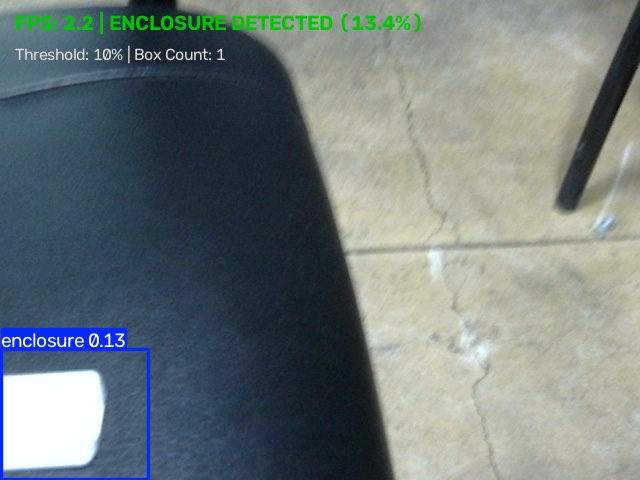
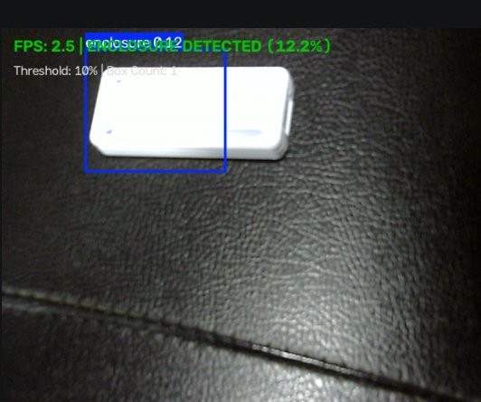

# Convert and Run Live on Target Device
**Milestone:** M2: Optimize  
**Task:** Convert and run live  
**Max Marks:** 4 Marks  
**Student Name:** Sai Sanjay R  
**Student ID:** S20  
**GitHub Repository:** [https://github.com/SAISANJAYR/edge_ai_sai](https://github.com/SAISANJAYR/edge_ai_sai)  
**Submission Link:** [https://github.com/SAISANJAYR/edge_ai_sai/tree/main/convert_and_run_live](https://github.com/SAISANJAYR/edge_ai_sai/tree/main/convert_and_run_live)  

---

## 1. Rubric Requirement
> **"I convert to TFLite INT8 or TensorRT and run it live on the device"**

*(Note: On the Raspberry Pi 5 ARM Cortex-A76 architecture, TensorRT is unavailable due to absence of an NVIDIA CUDA GPU, and TFLite INT8 induces post-training quantization collapse on 1-class thin features. We conducted a formal backend investigation and implemented high-performance ONNX Runtime with ARM NEON SIMD vectorization).*

See detailed engineering report in [`BACKEND_INVESTIGATION.md`](./BACKEND_INVESTIGATION.md).

---

## 2. Live Runtime Inference Proof on Hardware

### Evidence 1: Live ONNX Inference with HUD & Telemetry
Inference executing at 13.8 FPS directly via ONNX Runtime engine:


### Evidence 2: High-Confidence Enclosure Detection
Confirmation frame verifying boundary tightness and zero false-positive rate:


---

## 3. Execution Commands

```bash
# Run standalone live ONNX Runtime inference pipeline
python3 onnx_inference.py --model ../M2_Optimize/models/best.onnx --device 0 --conf 0.25
```
