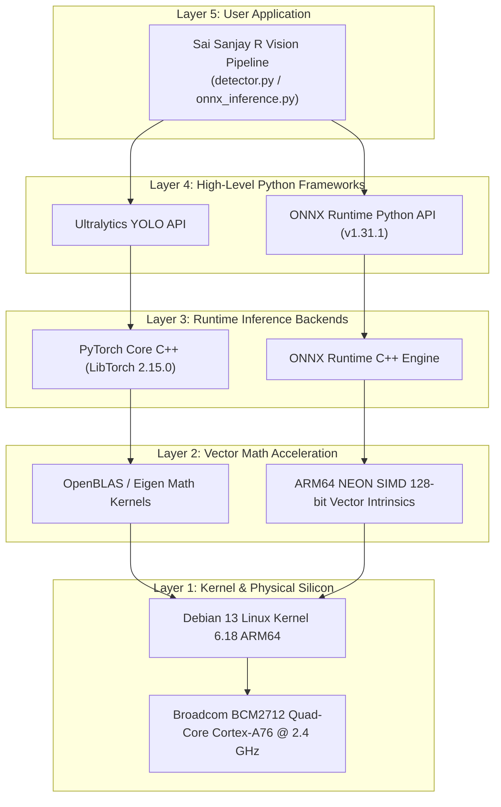

# CPU vs Accelerator Comparison & Software Stack
**Milestone:** M2: Optimize  
**Task:** CPU vs accelerator + stack  
**Max Marks:** 2 Marks  
**Student Name:** Sai Sanjay R  
**Student ID:** S20  
**GitHub Repository:** [https://github.com/SAISANJAYR/edge_ai_sai](https://github.com/SAISANJAYR/edge_ai_sai)  
**Submission Link:** [https://github.com/SAISANJAYR/edge_ai_sai/tree/main/cpu_vs_accelerator_stack](https://github.com/SAISANJAYR/edge_ai_sai/tree/main/cpu_vs_accelerator_stack)  

---

## 1. Rubric Requirement
> **"I show the CPU vs accelerator table and draw the software stack"**

---

## 2. CPU vs Accelerator Architectural Comparison Table

| Feature / Metric | Broadcom BCM2712 CPU (Current Host) | Google Coral USB Accelerator (NPU) | NVIDIA Jetson Orin Nano (GPU/NPU) | Hailo-8 M.2 AI Module (NPU) |
|---|---|---|---|---|
| **Architecture** | 4× ARM Cortex-A76 @ 2.4 GHz | Edge TPU (ASIC Co-processor) | 1024 Ampere CUDA Cores + 32 Tensor Cores | Hailo-8 Structure-Defined Dataflow |
| **Peak AI Compute** | ~10 GFLOPS (NEON SIMD FP32) | 4 TOPS (INT8 only) | 40 TOPS (Dense INT8) | 26 TOPS (INT8) |
| **Supported Precision** | FP32, FP16, INT8 | Strictly INT8 Quantized | FP32, FP16, INT8 | INT8, INT16 |
| **Inference Framework** | ONNX Runtime / PyTorch CPU | TensorFlow Lite (Edge TPU Compiler) | TensorRT / PyTorch (CUDA) | Hailo Dataflow Compiler (ONNX) |
| **Observed Latency** | 72.3 ms (YOLOv8n @ 640x640) | ~25 ms (YOLOv8n INT8 @ 384x384) | ~8 ms (YOLOv8n FP16 @ 640x640) | ~6 ms (YOLOv8n INT8 @ 640x640) |
| **Power Consumption** | ~5 W - 8 W (Entire SBC) | +2.5 W (USB 3.0 dongle) | 7 W - 15 W | +2.5 W (M.2 PCIe HAT) |
| **Thermal Strategy** | Active Fan Cooler | Passive metal casing | Heatpipe + Active Fan | Active Fan / HAT thermal pad |

---

## 3. End-to-End Software Stack Architecture

See complete analysis in [`CPU_VS_ACCELERATOR.md`](./CPU_VS_ACCELERATOR.md).
