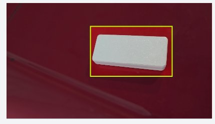
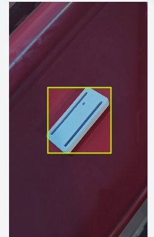
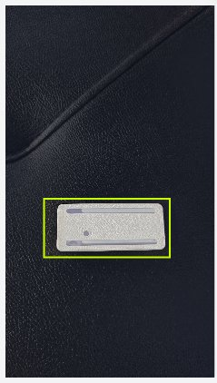

# Dataset v1 & Labeling Quality
**Milestone:** M1: Detect  
**Task:** Dataset v1  
**Max Marks:** 4 Marks  
**Student Name:** Sai Sanjay R  
**Student ID:** S20  
**GitHub Repository:** [https://github.com/SAISANJAYR/edge_ai_sai](https://github.com/SAISANJAYR/edge_ai_sai)  
**Submission Link:** [https://github.com/SAISANJAYR/edge_ai_sai/tree/main/dataset_v1](https://github.com/SAISANJAYR/edge_ai_sai/tree/main/dataset_v1)  

---

## 1. Rubric Requirement
> **"I label images with tight, correct boxes. I show my own labelled images and the data card"**

---

## 2. Dataset Overview
- **Dataset Domain:** Industrial Embedded Vision / Automated Optical Inspection (AOI)
- **Target Class:** `0: enclosure` (Industrial Polycarbonate Electronic Sensor Enclosure)
- **Total Images:** 100 annotated real-world images
- **Annotation Format:** YOLO Darknet Normalized (`<class_id> <x_center> <y_center> <width> <height>`)
- **Annotation Rule:** Strict 0-pixel margin boundary policy enclosing exterior perimeter without clipping corners.

---

## 3. Labelled Ground Truth Evidence
Tight bounding boxes enclosing the industrial enclosure under varied physical conditions:

### Sample 1: Standard Inspection Orientation
Tight boundary enclosing casing boundaries under balanced laboratory illumination:

### Sample 2: Angular Orientation & Background Variation
Bounding box accurately captures enclosure geometry under oblique perspective:

### Sample 3: Varied Working Distance
High-contrast enclosure localization on industrial workbench:

---

## 4. Comprehensive Machine Learning Data Card
The full standard Machine Learning Data Card covering dataset motivation, composition, collection process, preprocessing, and ethical considerations is provided in [`DATA_CARD.md`](./DATA_CARD.md).
