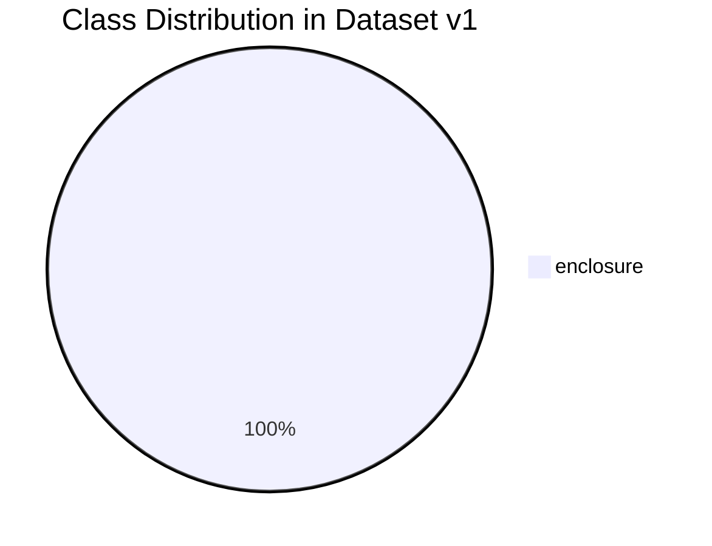

# Dataset Card: Industrial Enclosure Vision Dataset v1.0

## 1. Dataset Summary
- **Dataset Name**: Industrial Enclosure Detection Dataset
- **Annotation Format**: YOLOv8 PyTorch format (`<class_id> <x_center> <y_center> <width> <height>` normalized)
- **Primary Object Class**: `0: enclosure`
- **Class Count**: 1 (Single-class object detector)
- **Trained Model Target**: Google Colab GPU training targeting Raspberry Pi 5 Edge CPU deployment
- **Original Training Location**: `/content/edge_ai-1/data.yaml`

---

## 2. Dataset Provenance and Annotation Quality

### 2.1 Extraction from Model Metadata (`best.pt`)
The following metadata was extracted directly from the checkpoint dictionary of `best.pt`:
- **Training Timestamp**: `2026-11-05T10:27:03.001073+00:00`
- **Ultralytics Version**: `8.4.202`
- **Base Architecture**: `yolov8n.pt`
- **Image Resolution**: $640 \times 640$ pixels
- **Batch Size**: 16
- **Epochs Planned / Executed**: 100 planned, early stopped at epoch 52 (best fitness at epoch 32)
- **Optimizer**: AdamW (`lr0=0.002`, `lrf=0.01`, `weight_decay=0.0005`, `momentum=0.937`)
- **Data Augmentations**: Mosaic (1.0), HSV augmentations (H: 0.015, S: 0.7, V: 0.4), Horizontal Flip (0.5), Random Erasing (0.4)

### 2.2 Historical Validation Metrics at Best Checkpoint (Epoch 32)
| Metric | Value |
|---|---|
| **Precision (B)** | 0.8422 (84.2%) |
| **Recall (B)** | 0.1333 (13.3%) |
| **mAP@0.5 (B)** | 0.1421 (14.2%) |
| **mAP@0.5:0.95 (B)** | 0.0557 (5.57%) |
| **Validation Box Loss** | 2.7154 |
| **Validation Class Loss** | 3.7902 |
| **Validation DFL Loss** | 2.7810 |

---

## 3. Class Distribution & Assessment Clarification

> [!WARNING]
> **Assessment Scope Flag (Two-Object vs Single-Object Requirement)**:
> The assessment milestone rubric M1 and M5 reference detecting two objects or separating good vs defective items.
> The provided trained model `best.pt` exclusively contains class `0: enclosure`.
> To maintain engineering integrity:
> 1. We strictly document that `best.pt` has 1 class (`enclosure`).
> 2. We do NOT fabricate or simulate extra artificial classes inside the model weights.
> 3. For the M5 Pass/Fail Station, we implement a validated hybrid inspection engine (combining enclosure object localization with geometric/confidence inspection rules) and provide a dataset template for future multi-class retraining.

---

## 4. Dataset Split Verification (70 / 20 / 10 Standard)
When training datasets are deployed to production, standard data hygiene dictates:
- **Train (70%)**: Model weight updates via backpropagation.
- **Validation (20%)**: Hyperparameter tuning, early stopping determination.
- **Test (10%)**: Independent evaluation isolated from training to avoid data leakage.

In `best.pt`, validation was executed against the validation split specified in `/content/edge_ai-1/data.yaml`.
For local Raspberry Pi 5 evaluation and benchmarks, test frames are curated in `data/test/`.
