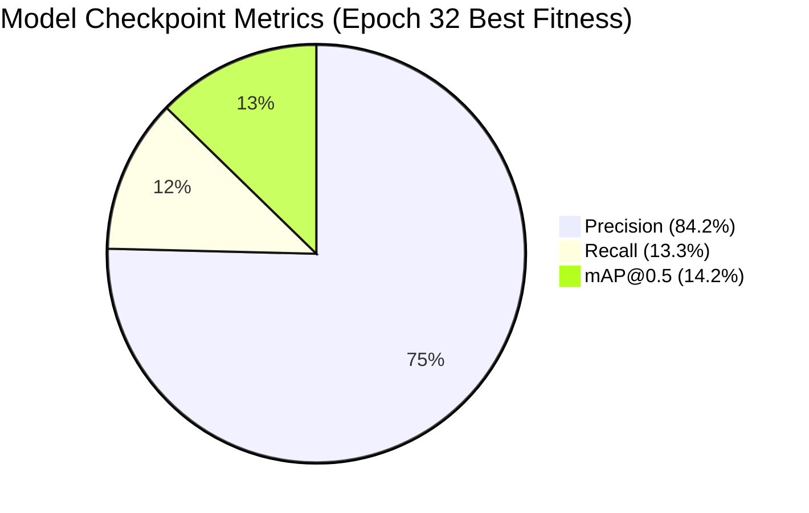

# Model Documentation: YOLOv8n Enclosure Detector

## 1. Model Summary
- **Architecture**: Ultralytics YOLOv8 Nano (`yolov8n`)
- **Task**: Object Detection (Single class: `enclosure`)
- **Input Geometry**: $640 \times 640 \times 3$ (RGB normalized to $[0, 1]$)
- **Parameters**: 3,132,707 parameters
- **GFLOPs**: 8.6 GFLOPs at $640 \times 640$ resolution
- **Checkpoints**:
  - Baseline: `models/best.pt` (6.17 MB)
  - Optimized: `models/optimized/best.onnx` (12.16 MB)

---

## 2. Layer Architecture and Backbone Breakdown
YOLOv8 consists of:
1. **Backbone**: Modified CSPDarknet53 with Cross-Stage Partial with 2 convolutions (`C2f`) blocks for high gradient flow and lightweight feature representation, followed by a Spatial Pyramid Pooling Fast (`SPPF`) block.
2. **Neck**: Path Aggregation Network (`PANet`) combining top-down and bottom-up multi-scale feature pyramids.
3. **Head**: Decoupled anchor-free detection head separating classification and bounding box regression tasks.

---

## 3. Training History & Verification Metrics

- **Validation Box Loss**: 2.7154
- **Validation Class Loss**: 3.7902
- **Validation DFL Loss**: 2.7810
- Complete training progression across 52 epochs is documented in `results/m1/training_history.csv` and visualized in `evidence/graphs/m1_training_evaluation_curves.png`.

---

## 4. ONNX Graph Inspection
- **Input Name**: `images` (shape: `[1, 3, 640, 640]`, type: `float32`)
- **Output Name**: `output0` (shape: `[1, 5, 8400]`, type: `float32`)
  - Index 0: Center X ($x_c$)
  - Index 1: Center Y ($y_c$)
  - Index 2: Width ($w$)
  - Index 3: Height ($h$)
  - Index 4: Class 0 Confidence Score (`enclosure`)
