# Performance Evaluation & Comparative Report

## 1. Overview
This report synthesizes all empirical performance measurements collected on the physical Raspberry Pi 5 hardware across Milestone 1 (PyTorch Baseline) and Milestone 2 (ONNX Runtime Optimization).

---

## 2. Comprehensive Empirical Benchmark Matrix

| Evaluation Dimension | M1: PyTorch CPU (Baseline) | M2: ONNX Runtime CPU (Optimized) | Empirical Delta / Gain |
|---|---|---|---|
| **Inference Engine** | PyTorch 2.15.0+cpu | ONNX Runtime 1.31.1 | Native ARM64 C++ execution |
| **Model File** | `models/best.pt` | `models/optimized/best.onnx` | Formally exported and verified |
| **Model Size on Disk** | **6.17 MB** | **12.16 MB** | +5.98 MB (Uncompressed ONNX) |
| **Warm-up Runs** | 10 runs | 10 runs | Cache and frequency stabilization |
| **Timed Benchmark Runs** | 50 runs | 50 runs | Identical reference frame ($B=1$) |
| **Input Resolution** | $640 \times 640$ | $640 \times 640$ | Preserved resolution |
| **Median Latency** | **231.25 ms** | **185.89 ms** | **-45.36 ms (1.24x faster, 19.6% reduction)** |
| **Mean Latency** | 236.20 ms | 192.21 ms | -43.99 ms |
| **P95 Latency** | **272.74 ms** | **229.31 ms** | **-43.43 ms (Tail latency improved 15.9%)** |
| **Min Latency** | 206.28 ms | 158.57 ms | -47.71 ms |
| **Max Latency** | 384.86 ms | 360.15 ms | -24.71 ms |
| **Median Throughput** | **4.32 FPS** | **5.38 FPS** | **+1.06 FPS (+24.4% throughput)** |
| **Mean Throughput** | 4.28 FPS | 5.29 FPS | +1.01 FPS |
| **Mean CPU Utilization** | 82.2% | 99.8% | Full 4-core multi-threaded saturation |
| **Average SoC Temperature** | 74.9°C | 84.4°C | Controlled by active cooler |
| **Peak SoC Temperature** | 79.8°C | 85.9°C | No thermal throttling trip |
| **Average RAM Usage** | 2,986.7 MB | 3,035.9 MB | Well within 4GB system memory |

```mermaid
xychart-beta
    title "Latency Comparison: Baseline vs Optimized (ms)"
    x-axis ["Median Latency", "Mean Latency", "P95 Latency"]
    y-axis "Latency (ms)" 0 --> 300
    bar [231.3, 236.2, 272.7]
    bar [185.9, 192.2, 229.3]
```

---

## 3. Accuracy and Numerical Parity Analysis
- **Max Absolute Difference**: $2.2888 \times 10^{-4}$
- **Mean Absolute Difference**: $1.0086 \times 10^{-5}$
- **Parity Status**: **Confirmed**. Both engines produce identical detections with confidence scores matching within four decimal places.
- Accuracy Parity Plot: `evidence/graphs/m2_accuracy_comparison.png`

---

## 4. Hardware Efficiency & Thermal Stability
- Under continuous 50-iteration benchmark runs, the Broadcom BCM2712 Cortex-A76 cores operate at full multi-threaded capacity.
- The Raspberry Pi 5 Active Cooler maintains operating temperatures $\le 85.9^\circ\text{C}$, preventing hard thermal throttling.
