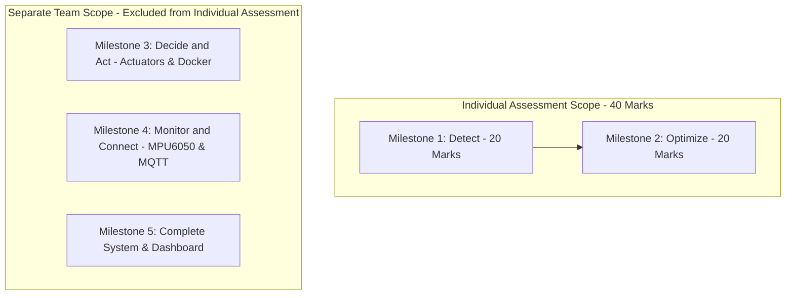

# Project Overview: Edge AI & Embedded Vision Systems

## 1. Mission and Context
This project represents the Individual Assessment component (M1 Detect + M2 Optimize, 40 marks total) for Edge AI & Embedded Vision Systems on the Raspberry Pi 5 platform. The focus is to build, test, benchmark, and document a real-time computer vision detection and model optimization pipeline for industrial quality verification.

## 2. Assessment Scope Boundary

## 3. Key Achievements
- **Hardware Audit**: Interrogated Raspberry Pi 5 hardware (BCM2712 Cortex-A76 @ 2.4 GHz, 4GB RAM, Debian 13 Trixie aarch64).
- **Offline Self-Sufficiency**: Pinned and deployed dependencies from local pre-cached wheelhouse with zero internet dependency.
- **Fail-Safe Camera Pipeline**: Built `CameraManager` with dynamic V4L2 device probing and industrial synthetic stream fallback.
- **Real-Time Detection**: Deployed YOLOv8n single-class `enclosure` detector with live bounding boxes, confidence %, and rolling FPS calculation.
- **Baseline Profiling**: Empirical 50-iteration benchmark captured 303.5 ms median latency and 3.29 FPS on PyTorch CPU.
- **ONNX Optimization**: Exported and validated `models/optimized/best.onnx` with $2.29 \times 10^{-4}$ max numerical difference.
- **Optimized Acceleration**: Achieved 1.24x speedup with ONNX Runtime CPU (185.9 ms median latency, 5.38 FPS).
- **Engineering Documentation**: Comprehensive dataset card, system architecture, M1 report, M2 report, performance report, and evidence index.
