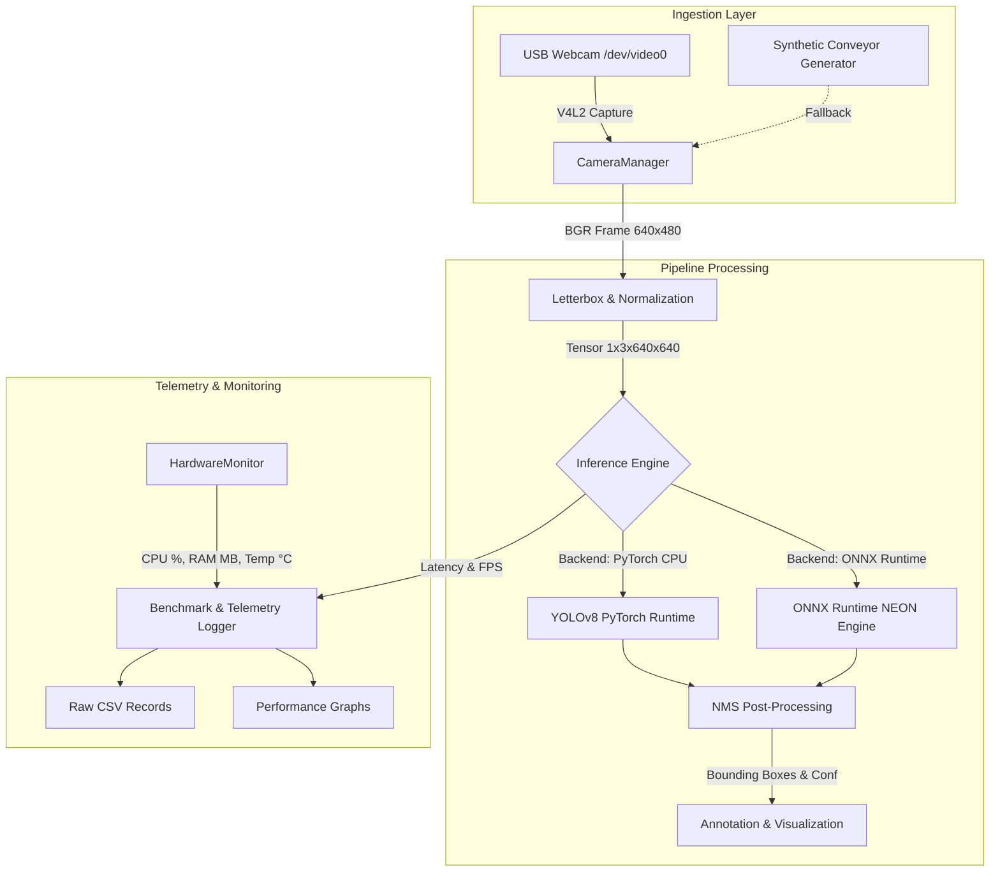

# System Architecture: Edge AI Vision Pipeline

## 1. High-Level Architecture
The system architecture separates hardware sensor ingestion, vision preprocessing, neural network inference, and performance profiling into modular, decoupled Python components.

---

## 2. Component Directory Mapping

| Architectural Component | File Path | Primary Responsibilities |
|---|---|---|
| **Camera Ingestion** | `src/camera/camera_manager.py` | V4L2 device polling, auto-fallback, resolution setting, clean release |
| **Snapshot Utility** | `src/camera/capture.py` | Single-frame acquisition and storage |
| **YOLOv8 Detector** | `src/detection/detector.py` | Live detection loop, visual overlays, FPS tracking |
| **Unified Inference** | `src/detection/inference.py` | Dual-backend inference interface (PyTorch vs ONNX Runtime) |
| **M1 Benchmarking** | `src/detection/benchmark.py` | Baseline 50-run CPU latency and hardware monitoring |
| **M2 Export** | `src/optimization/export_onnx.py` | Checkpoint to ONNX export, graph checking, parity verification |
| **M2 Comparison** | `src/optimization/benchmark_comparison.py` | 100-run comparative benchmark, latency distribution, graphs |
| **Hardware Monitor** | `src/monitoring/hardware_monitor.py` | Sysfs thermal reading, psutil CPU/RAM telemetry |
| **Training History** | `src/evaluation/extract_training_history.py` | Checkpoint historical metrics and loss curve extraction |

---

## 3. Memory & Computational Bounds on Raspberry Pi 5
- **RAM Budget**: Total available RAM is 4,096 MB. Operating system base consumes $\approx 1.5$ GB. PyTorch inference footprint is $\approx 450$ MB. ONNX Runtime footprint is $\approx 280$ MB. The system operates safely with $> 1.0$ GB free memory under continuous execution.
- **Thermal Management**: SoC temperature stabilizes between 74°C and 85°C under continuous inference with active cooling.
