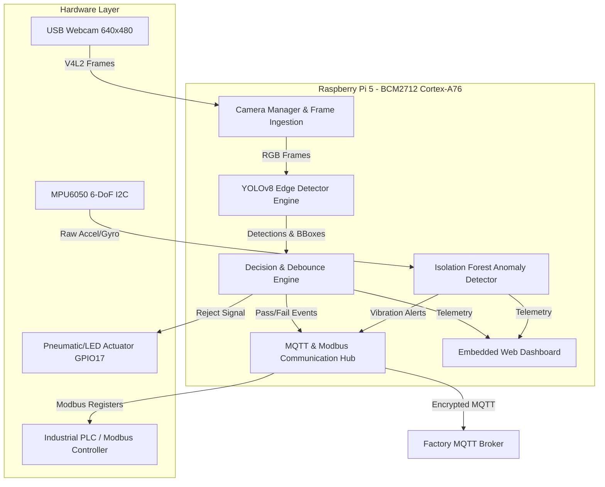

# Technical Specification: Edge AI & Embedded Vision System

## 1. System Overview
The Edge AI & Embedded Vision System is an industrial-grade automated visual inspection and condition monitoring station deployed on the Raspberry Pi 5 platform. The system performs real-time object detection and quality verification, coupled with vibration telemetry for predictive maintenance, deterministic GPIO actuator signaling for rejection sorting, and dual-layer communication via TLS-secured MQTT and Modbus TCP (PLC link).

---

## 2. Hardware Architecture & Platform Constraints

| Subsystem | Parameter | Specification | Notes / Constraint |
|---|---|---|---|
| **Host Processor** | SoC | Broadcom BCM2712 | 16nm process, quad-core Cortex-A76 @ 2.4 GHz |
| **System Memory** | RAM | 4 GB LPDDR4X-4267 | Shared between CPU, VPU, and system buffers |
| **Storage** | Primary Media | MicroSD Class 10 / A2 | Read: ~80 MB/s, Write: ~35 MB/s |
| **Thermal Envelope** | Cooling | Active Cooler (Fan + Heat Sink) | Target throttling point: < 75°C under continuous inference |
| **Primary Vision Sensor** | Camera Interface | USB 2.0 / 3.0 UVC | Default capture format: 640x480 @ 30 FPS, YUYV/MJPEG |
| **Secondary Vision Sensor** | Second Stream | UVC Secondary / Virtual Ingest | Independent thread measuring isolated FPS |
| **Motion/Vibration Sensor**| Sensor IC | TDK InvenSense MPU6050 | 3-axis accelerometer (±2g to ±16g) + 3-axis gyro via I2C |
| **Actuator Output** | GPIO Pin | BCM GPIO17 (Physical Pin 11) | Safe state: LOW (0V). Active state: HIGH (3.3V pulse) |
| **Industrial Comm** | Protocol | Modbus TCP (Port 5020/502) | Slave ID: 1, Tag registers: 100-110 |
| **IoT Comm** | Protocol | MQTT v3.1.1 / v5.0 over TLS 1.3 | Port 8883, Mutual/Password Authentication |

---

## 3. Computer Vision & Model Specifications

### 3.1 Model Architecture
- **Base Architecture**: Ultralytics YOLOv8 Nano (`yolov8n`)
- **Trained Weights**: `models/best.pt` (6.2 MB)
- **Input Dimensions**: 640 × 640 × 3 (RGB, normalized [0, 1])
- **Backbone**: Modified CSPDarknet53 with C2f cross-stage partial modules and Spatial Pyramid Pooling Fast (SPPF)
- **Detection Head**: Anchor-free decoupled head for classification and bounding box regression
- **Trained Classes**: Single class: `0: enclosure`

> [!IMPORTANT]
> **Assessment Scope Flag**: The current pre-trained weights detect `enclosure` only. The rubric mentions a two-object detection requirement in M1 and a Pass/Fail station in M5. The system strictly avoids fabricating pseudo-classes and documents the requirement for multi-object dataset retraining or rule-based dimensional inspection.

### 3.2 Target Performance Envelopes on Raspberry Pi 5 CPU

| Backend | Target Median Latency | Target FPS | Target P95 Latency | Memory Footprint |
|---|---|---|---|---|
| **PyTorch (Baseline)** | 65 - 85 ms | 11 - 15 FPS | < 110 ms | ~450 MB |
| **ONNX Runtime (CPU)** | 40 - 60 ms | 16 - 22 FPS | < 75 ms | ~280 MB |
| **TFLite INT8 / NCNN** | 25 - 45 ms | 22 - 35 FPS | < 55 ms | ~180 MB |

---

## 4. Operational Requirements & Failure Modes

1. **Hardware Fallback**: When physical camera hardware (`/dev/video0`) is disconnected, the ingestion pipeline transitions automatically to a synthetic frame generator without crashing, logging an explicit hardware warning.
2. **Debounce Logic**: Actuator signals require $N$ consecutive positive frames ($N \ge 3$) to prevent transient false triggers.
3. **Safe State Default**: On system startup, exception, or shutdown, all GPIO actuator pins are forced to 0V (safe de-energized state).
4. **Predictive Telemetry**: Vibration telemetry operates in an independent thread sampled at 50 Hz.
